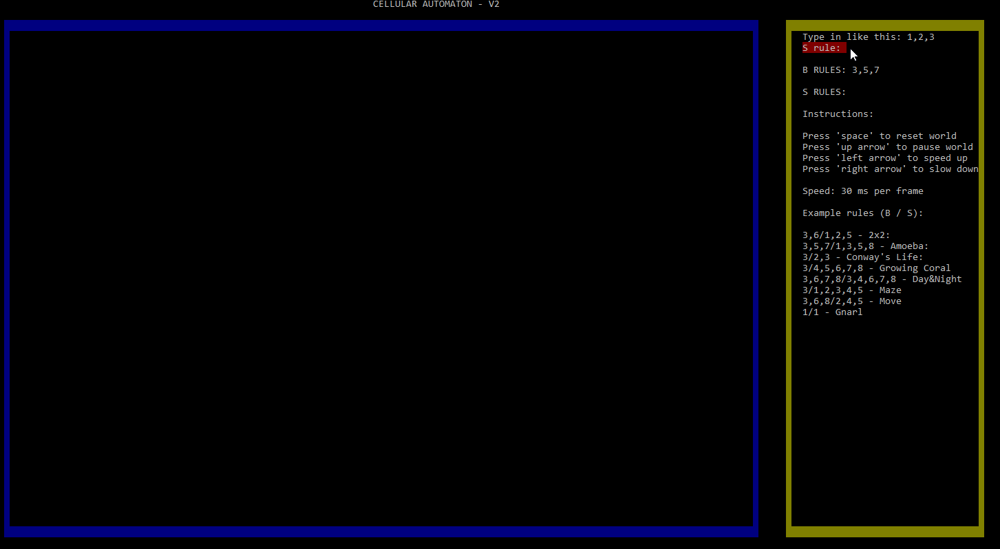

# cellular_automaton

last updated: 25/11/2026 (9pm)

A cellular automaton engine for the terminal that can run many 'Life'-like rules, including Conway's Game of Life (the default, B3/S23), in honour of John Horton Conway.
It ships with ~40 preset rules, including Generations rules (cells fade through "dying" states, e.g. Brian's Brain), and you can type your own rules as well if you want to.

Built with [tcell](https://github.com/gdamore/tcell). Each terminal character shows two cells using half-block glyphs, so cells are roughly square, and live cells are coloured by age (red = newborn → blue = long-lived). The world wraps at the edges and resizes with the terminal.

## Run

```sh
go run .
```

Needs a terminal of at least 56x31 with mouse support and ideally 24-bit colour (Windows Terminal, most Linux/macOS terminals).

## Controls

| Input | Action |
|---|---|
| left click | cycle the two cells in a character: top → bottom → both → empty |
| left drag | draw cells |
| right click / drag | erase cells |
| space | clear world |
| r | random fill |
| [ / ] | previous / next preset rule |
| e (or click the red button) | type a custom rule |
| up arrow / p | pause / resume |
| n | single step (while paused) |
| left / right arrow | speed up / slow down |
| q / ctrl-c | quit |

## Rules

Rules use the standard notation `B<birth counts>/S<survive counts>`, optionally with `/C<states>` for Generations rules:

- `B3/S23` - Conway's Life: a dead cell with 3 live neighbours is born; a live cell with 2 or 3 survives.
- `B36/S23` - HighLife.
- `B2/S/C3` - Brian's Brain: cells that don't survive pass through `C-2` dying states (which don't count as live neighbours) before becoming dead.

Commas and lower case are accepted (`b3,6/s2,3`). Typing a rule that matches a preset selects that preset. Rules with B0 work but make the background flash, since every empty cell is born.

## Demo (older termbox version - will be updated soon!)


